# LearnHub - Final Project Report

**Subject:** React & Node JS (MERN Stack)  
**Batch:** 3  
**Total Marks:** 40

## 1. Project Overview
LearnHub is a learning management system where students browse and enroll in courses, instructors manage courses and lessons, and admins review analytics and manage user roles.

## 2. Technologies Used
- React JS
- React Router
- Axios
- Node.js and Express.js
- MongoDB and Mongoose
- JWT and bcryptjs
- CSS

## 3. Project Structure
The project is organized into separate `backend` and `frontend` applications. See `README.md` for the folder structure and setup instructions. A VS Code tree screenshot was not captured.

## 4. Home and Course Pages
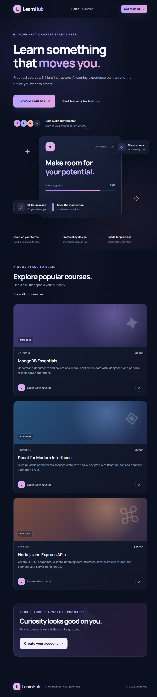

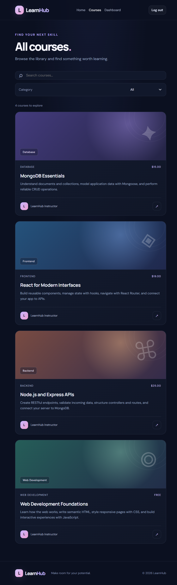

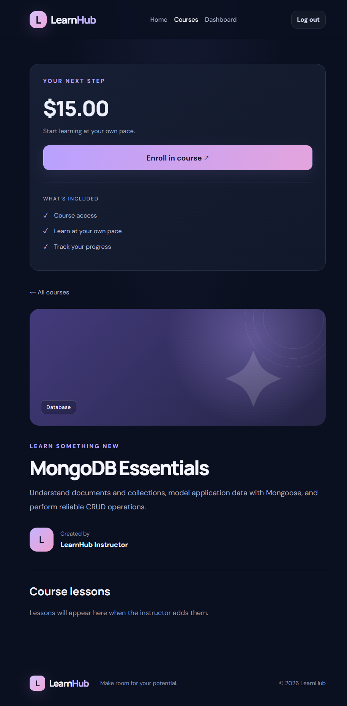

## 5. Login and Registration
Registration and login were tested in the browser; invalid credentials displayed an error.

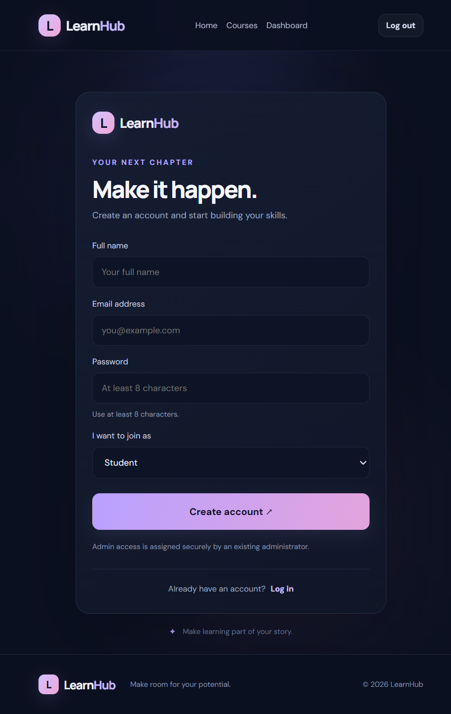

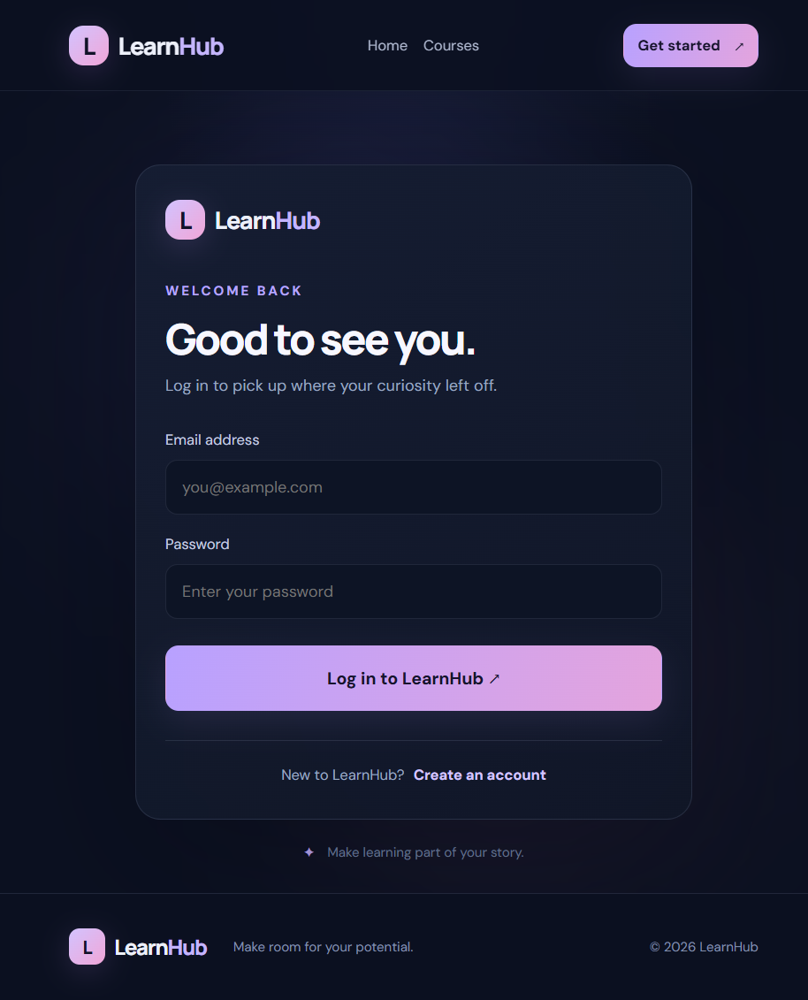

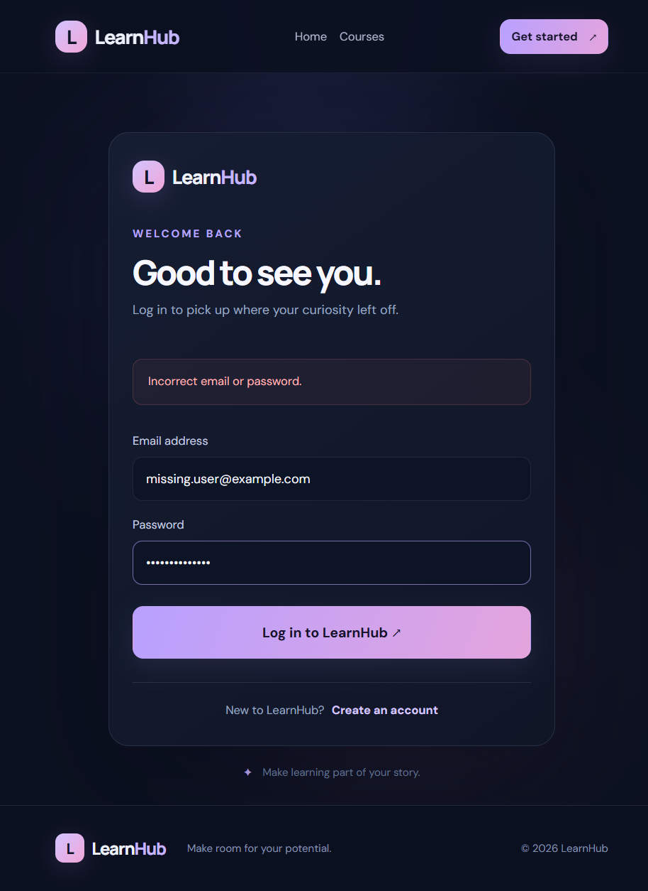

## 6. User Roles
LearnHub has three roles: Student, Instructor, and Admin. Each role has different options.

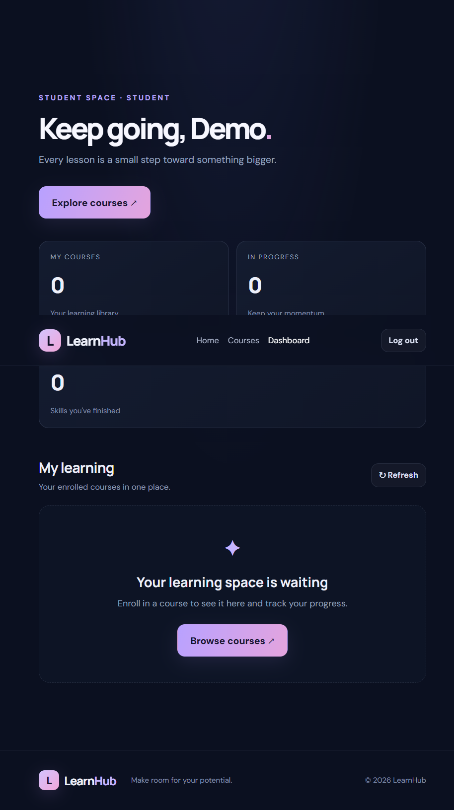

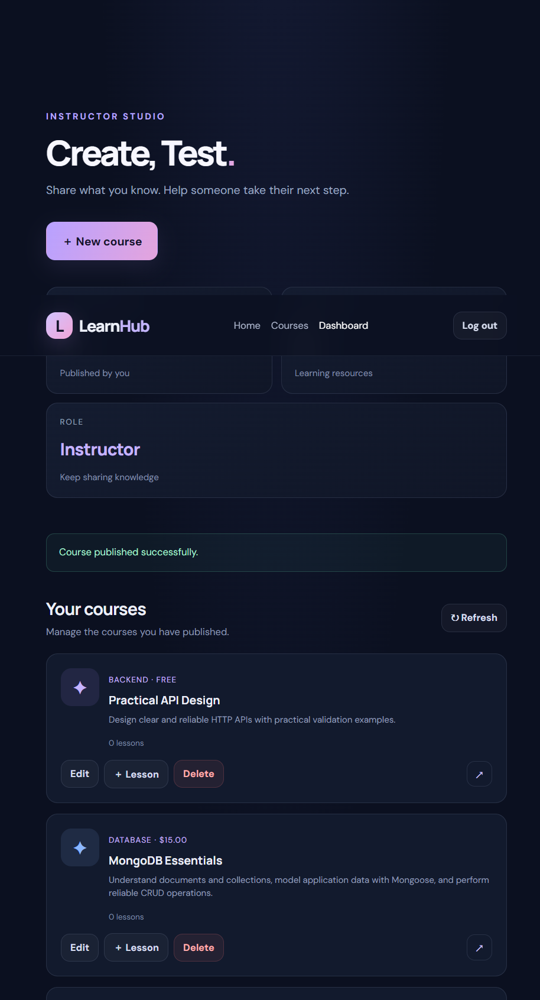

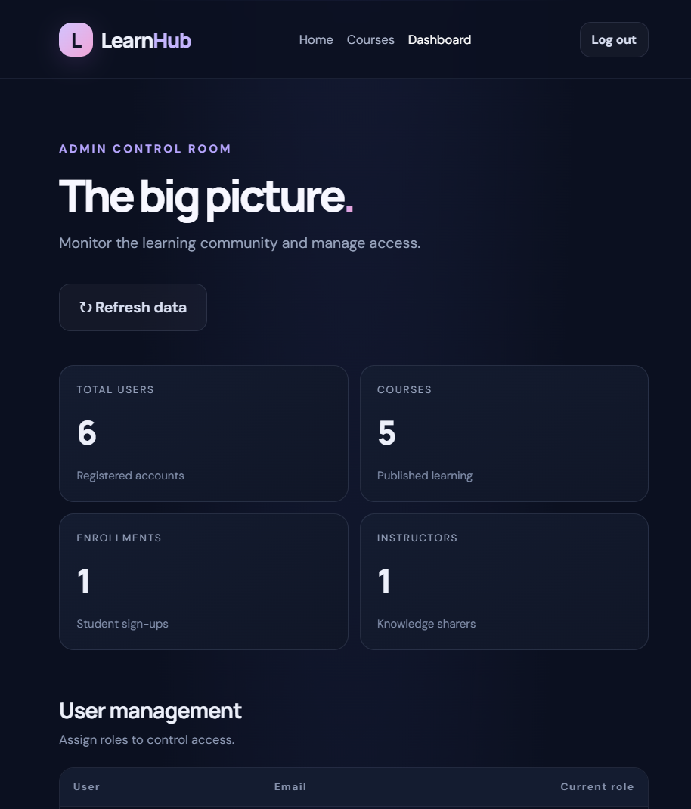

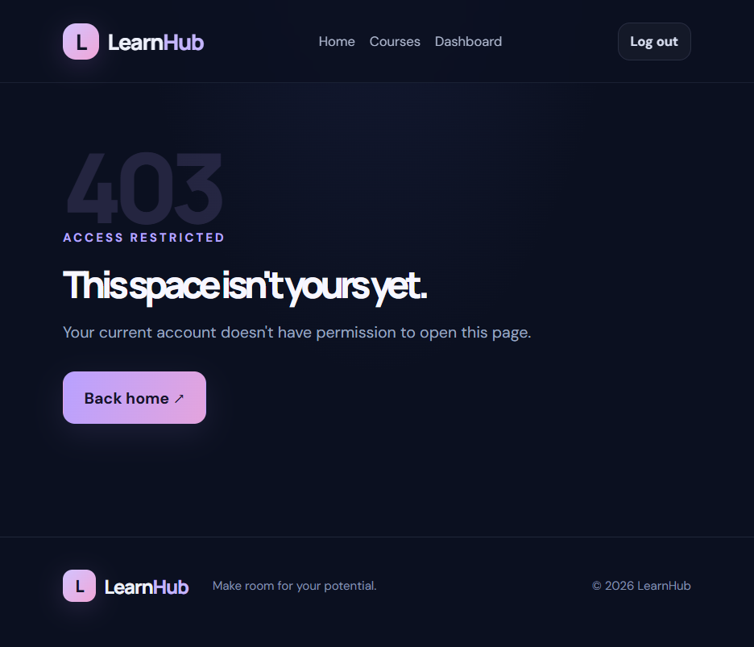

## 7. Course Enrollment
Students can enroll in courses and view their enrolled courses on the My Courses page.

The student enrolled in MongoDB Essentials and updated its progress to 10%.

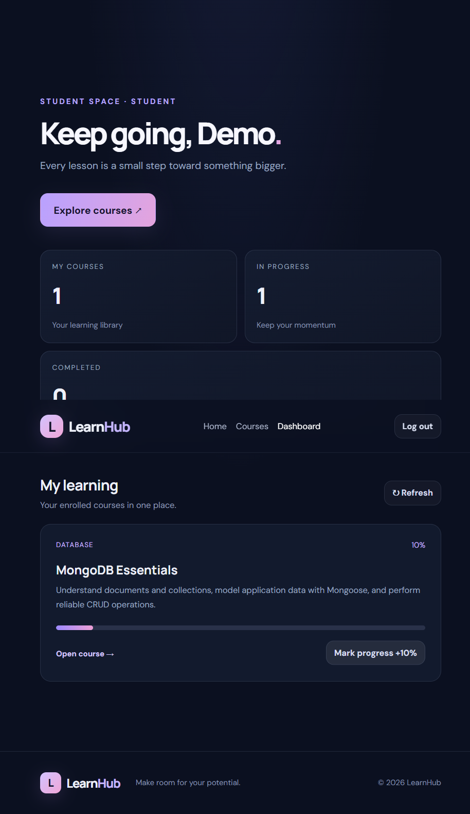

## 8. API Testing
Live API requests verified registration and login/JWT, course create/update/delete and lesson creation, student enrollment and My Courses, and admin analytics. Error checks confirmed duplicate enrollment returns `409`, role-denied actions return `403`, unauthenticated admin access returns `401`, and invalid credentials return `401`.

The bundled Postman collection was not used, so no Postman screenshots are claimed.

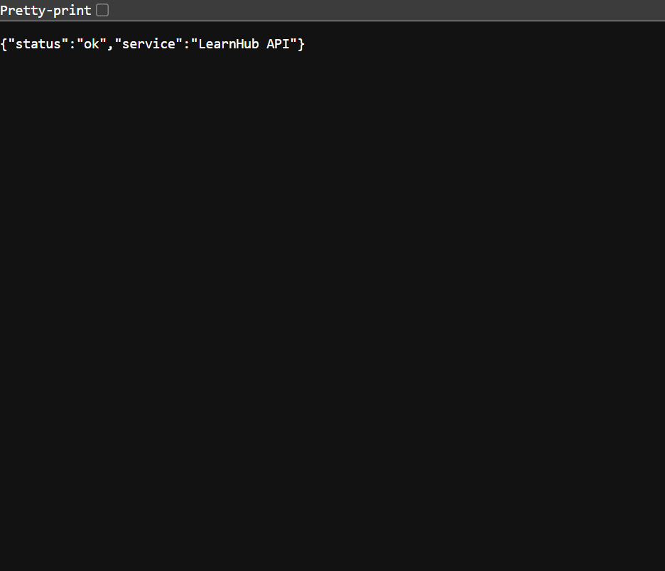

## 9. Backend and Database
The backend ran on port 5000 and connected successfully to the local MongoDB 8.3 service. The `/api/health` endpoint returned `{"status":"ok","service":"LearnHub API"}`. A terminal screenshot was not captured.

## 10. Build and Deployment
The frontend `npm run build` completed successfully. The application was tested locally at `http://localhost:5173`; it has not been deployed, so there is no deployed URL. A build-terminal screenshot was not captured.

## 11. How to Run the Project
The installation and running steps are given in the `README.md` file.

## 12. Conclusion
LearnHub demonstrates a full-stack MERN application with authentication, role-based access, course management, student enrollment, and progress tracking. Screenshots in this report were captured from the local application during verification.